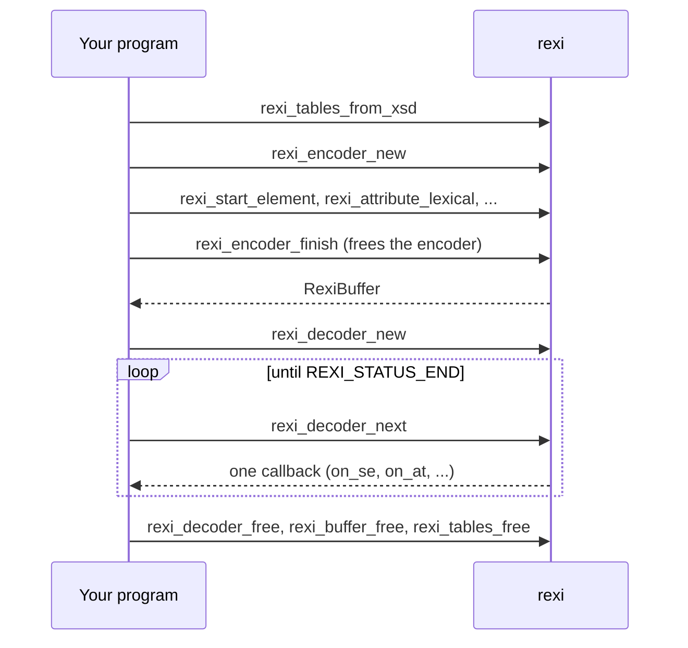

# Using rexi from C

In this chapter you'll write and read the same order from a C program.

*This chapter is for C only; Julia has no C API example.*

`rexi-capi` builds rexi as a C library (`librexi.a` or `librexi.so`) with one
header, `crates/rexi-capi/include/rexi.h`. The example in `examples/basics/c`
writes the order [event](glossary.md#event) by event, then reads it back. It
prints the same lines as [Reading events](read-events.md).

```bash
cargo build --release -p rexi-capi          # from the rexi folder
cd examples/basics
cmake -S c -B c/build && cmake --build c/build
c/build/order data/order.xsd
```

## The life of each handle

Everything you create, you free. The encoder is the one exception: `finish`
frees it and gives you a buffer, which you free later.



## Writing

Every call returns a `RexiStatus`. When it is not `REXI_STATUS_OK`,
`rexi_last_error()` tells you why:

```c
{{#include ../../examples/basics/c/order.c:write}}
```

The `_lexical` calls take a [text value](glossary.md#text-lexical-value) and
parse it with the schema's type, so `"42.95"` becomes a decimal.

## Reading

The decoder calls one of your functions for each event. You pass a pointer to
your own state (here, the indent depth), and it comes back in every callback:

```c
{{#include ../../examples/basics/c/order.c:read}}
```

Strings arrive as a `RexiStr`: a pointer and a length. Every value also has a
`lexical` text form, so you can print it without caring about its type.

## Limits

`rexi_decoder_new` and `rexi_decode` use the default limits, which protect you
from hostile streams. To pick your own, fill a `RexiLimits` (0 means no limit)
and call `rexi_decoder_new_with_limits` or `rexi_decode_with_limits`. Going over
a limit gives `REXI_STATUS_ERR_LIMIT`. [Untrusted input](untrusted-input.md) has
the details.

```c
RexiLimits limits = rexi_limits_default();
limits.max_depth = 1024;
RexiDecoder *dec = NULL;
RexiStatus s = rexi_decoder_new_with_limits(tables, data, len, &opts, &limits, &dec);
```
