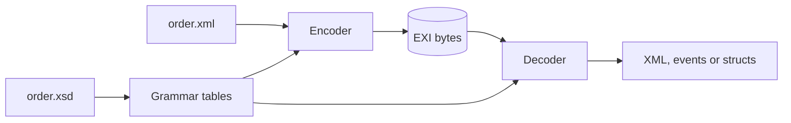

# Welcome

This guide shows you how to send XML as small binary messages from Rust and C,
one short example at a time.

rexi reads and writes **EXI** (Efficient XML Interchange), a W3C standard for
sending XML as compact binary. The order in this guide's examples is 538 bytes
of XML and only 129 bytes of EXI.

The trick is that both sides share the same XML [schema](glossary.md#schema).
Each side knows which elements and attributes can come next, and what type each
value has. So the stream doesn't have to spell out names or turn numbers into
text.

New to EXI? [Words you'll see](glossary.md) explains each term in a line or two.

## What you will learn

Each chapter follows one small program in `examples/basics`, from easiest to
hardest:

1. **Round trip**: XML to EXI and back in three calls.
2. **Options**: what the header holds, and what changes the size.
3. **Reading events**: walking a stream one item at a time.
4. **Writing events**: building a document without any XML text.
5. **Structs**: turning your own Rust types into EXI with serde.
6. **Prebuilt tables**: skipping the schema step when your program runs.
7. **Small devices**: writing into a fixed buffer, with no `std`.
8. **C**: the same ideas through the C API.

Every example has a Julia twin in JExi that prints exactly the same output, so
you can read the two languages side by side.

## What rexi doesn't do (yet)

rexi works in [strict](glossary.md#strict-and-non-strict), schema-informed mode
only. That is the most compact form EXI offers. Compression, schema-less
streams, non-strict mode and the "preserve" options (comments, prefixes and so
on) are refused with a clear error. rexi never quietly does something "close
enough" instead.
