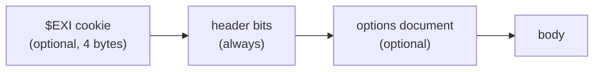

# Choosing options

In this chapter you'll pick the options that fit your use, and see how each one
changes the bytes.

Every EXI stream starts with a short [header](glossary.md#header). At its
smallest it is a single byte. It can also carry a `$EXI`
[cookie](glossary.md#cookie), so tools can spot the format, and an
[options](glossary.md#options) document that tells the decoder how the body was
written.



If the options are not in the header, both sides must agree on them some other
way, such as in a protocol spec or a config file. EXI calls this
[out of band](glossary.md#out-of-band).

```rust,ignore
{{#include ../../examples/basics/src/bin/options.rs:main}}
```

Output:

```text
bit-packed                    129 bytes  starts 80 07 a7 a9 22 16 99 18
byte-aligned                  145 bytes  starts 80 00 0f 4f 52 44 2d 32
options in header             129 bytes  starts a0 40 f4 f5 24 42 d3 23
cookie + options + schemaId   157 bytes  starts 24 45 58 49 a0 30 61 d5
all four decode to the same XML: true
compression: refused as unsupported
non-strict: refused as unsupported
```

## Which should I use?

| Setting | Pick it when |
|---|---|
| [Bit-packed](glossary.md#bit-packed-byte-aligned), options out of band | Both ends are yours. This is the smallest. |
| Options in the header | Readers shouldn't need to be told the options. For strict options this takes only a few bits, so here the size doesn't change. |
| Cookie | People or tools may need to recognize the file. The `24 45 58 49` above is `$EXI`. |
| `schemaId` | Readers should be able to check they have the right schema. |
| Byte-aligned | You are debugging. Text like `4f 52 44` (`ORD`) shows up in a hex dump. |

rexi refuses options it doesn't support when you build the encoder, so you find
out right away.
