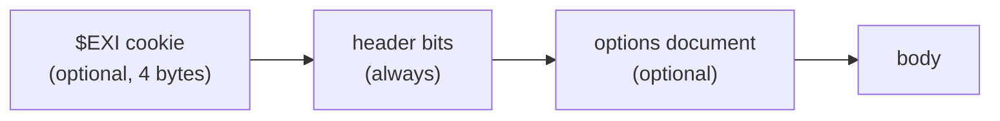

# Choosing options

In this chapter you'll pick the options that fit your use, and see how each one
changes the bytes.

Every EXI stream starts with a short [header](glossary.md#header). At its
smallest it is a single byte. It can also carry a `$EXI`
[cookie](glossary.md#cookie), so tools can spot the format, and an
[options](glossary.md#options) document that tells the decoder how the body was
written.



If the options are not in the header, both sides must agree on them some other
way, such as in a protocol spec or a config file. EXI calls this
[out of band](glossary.md#out-of-band).

```rust,ignore
{{#include ../../examples/basics/src/bin/options.rs:main}}
```

Output:

```text
bit-packed                    129 bytes  starts 80 07 a7 a9 22 16 99 18
byte-aligned                  145 bytes  starts 80 00 0f 4f 52 44 2d 32
options in header             129 bytes  starts a0 40 f4 f5 24 42 d3 23
cookie + options + schemaId   157 bytes  starts 24 45 58 49 a0 30 61 d5
all four decode to the same XML: true
compression: refused as unsupported
non-strict: refused as unsupported
```

## Which should I use?

| Setting | Pick it when |
|---|---|
| [Bit-packed](glossary.md#bit-packed-byte-aligned), options out of band | Both ends are yours. This is the smallest. |
| Options in the header | Readers shouldn't need to be told the options. For strict options this takes only a few bits, so here the size doesn't change. |
| Cookie | People or tools may need to recognize the file. The `24 45 58 49` above is `$EXI`. |
| `schemaId` | Readers should be able to check they have the right schema. Name the tables with the same id (`GrammarSetBuf::with_schema_id`, or `rexi_tables_with_schema_id` in C), and the decoder refuses a stream that names another schema. |
| Byte-aligned | You are debugging. Text like `4f 52 44` (`ORD`) shows up in a hex dump. |

rexi refuses options it doesn't support when you build the encoder, so you find
out right away.

## Fragments

A normal EXI body holds one document with one root element. Set the `fragment`
option to send a run of elements instead, such as tank level and flow readings
with no wrapper around them ([EXI 8.5.2](https://www.w3.org/TR/exi/#informedFragGrammars)). Each
element may be any element the schema declares, even one that is only declared
inside another element.

```rust,ignore
let options = ExiOptions::strict().with_fragment(true);
let xml = b"<level>...</level><flow>...</flow>"; // several roots, no wrapper
let exi = rexi::xml::encode_xml(xml, &tables, options.clone(), HeaderConfig::default())?;
let back = rexi::xml::decode_to_xml(&exi[..], &tables, Some(options))?;
```

The `rexi` tool takes `--fragment` for the same thing. One case is refused: when
two local elements share a name but have different types, EXI would read that
name at the top of a fragment with a looser grammar that rexi does not build.

## Wildcards

`xs:any` and `xs:anyAttribute` let a document put elements and attributes the
schema does not list in place ([EXI 8.5.4.1.6](https://www.w3.org/TR/exi/#elementTerms)).
rexi encodes and decodes them when it is built with the `wildcard` feature,
which is off by default so that small builds do not carry the code:

```toml
rexi = { version = "0.3", features = ["wildcard"] }
```

Each such element or attribute costs its name in the stream. An element needs
a global declaration in the schema, whose grammar it then follows. An element
with no declaration at all would need a built-in grammar, which rexi does not
have yet, so it is refused. An attribute is written in the type of its global
declaration, or as a string when it has none. Without the feature, the stream
is refused with `Unsupported(Wildcard)`.

## Exact values: `Preserve.lexicalValues`

Normally a value is sent in its type's compact form, so it decodes to the
type's standard text: `<price>1.50</price>` comes back as `1.5`, and `+05` as
`5`. When the exact text matters, for a signature over the XML or an audit
trail, turn on `Preserve.lexicalValues`
([EXI 6.3](https://www.w3.org/TR/exi/#fidelityOptions)). It is the one Preserve
option strict mode allows. rexi has it when built with the `lexical-values`
feature, which is off by default:

```toml
rexi = { version = "0.3", features = ["lexical-values"] }
```

```rust,ignore
let mut options = ExiOptions::strict();
options.preserve.lexical_values = true;
```

Each value is then its text, written with a small alphabet chosen by its type
(digits and signs for numbers, for example; EXI Table 7-2), and repeated values
still go through the string table. The messages are a little larger than
without the option. The text is kept as it is, spaces included, and so is
whitespace between elements where the schema allows text.

`xsi:type` is text as well, and a prefix in it would mean nothing to the
decoder, since strict mode does not send namespace prefixes. So with this
option `xsi:type` can only name a type in no namespace; `xsi:type="xs:int"` is
refused with `Unsupported(PreservePrefixes)`. EXIficient refuses it too.
Without the feature, the option is refused with
`Unsupported(PreserveLexicalValues)`.
