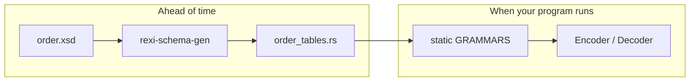

# Prebuilt tables

In this chapter you'll compile the schema once, ahead of time, so your program
starts with its tables ready.

Up to now, every program read and compiled `order.xsd` when it started. You can
do that work once and save the [grammar tables](glossary.md#grammar-grammar-tables)
as Rust code:

```bash
cargo run -p rexi-schema-gen -- examples/basics/data/order.xsd \
    --out examples/basics/src/order_tables.rs
```



The result is a module with a `static GRAMMARS`. Use it anywhere you used
compiled tables:

```rust,ignore
{{#include ../../examples/basics/src/bin/prebuilt_tables.rs:main}}
```

```text
EXI: 129 bytes
same bytes with compiled and prebuilt tables: true
decoded with prebuilt tables: <Order xmlns="urn:rexi:interop:order" orderId="ORD-2026-0007" priority="true">...
```

## Why bother?

- **No start-up cost.** The tables are ready the moment your program starts.
- **No XSD files to ship.** The schema is built into your program.
- **No heap for the tables.** That matters on small devices (next chapter).
- **Fast names.** The module also has a constant for every name, such as
  `LN_ORDER`. `Encoder::start_element_id(LN_ORDER)` skips the name lookup.

Add `--check` to the command in your build or CI. It fails if the file no longer
matches the schema.
