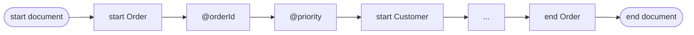

# Reading events

In this chapter you'll read a stream one piece at a time and get typed values.

`decode_to_xml` is handy, but sometimes you want the data, not the text. The
**pull decoder** gives you one [event](glossary.md#event) at a time: the start
of an element, an attribute, some content, or the end of an element.



You ask for the next event with `next_event`. It gives `None` when the document
is done:

```rust,ignore
{{#include ../../examples/basics/src/bin/read_events.rs:main}}
```

Output (shortened):

```text
start document
Order
  @orderId = ORD-2026-0007 (string)
  @priority = true (boolean)
  Customer
    ...
  Item
    @sku = BK-001 (string)
    Quantity
      2 (integer)
    Price
      42.95 (decimal)
  ...
end document
```

## What to notice

- **Values are typed.** `priority` arrives as a `bool` and `Quantity` as an
  integer. You don't have to parse text, because the schema already said what
  each one is.
- **Events borrow from the decoder.** An `Event` is only good until you ask for
  the next one. Copy out anything you want to keep, for example with
  `OwnedEvent::from_event`.
- **The decoder works as it reads.** It doesn't build the whole document in
  memory, so you can handle large streams piece by piece.
