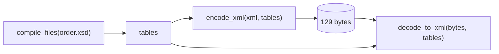

# Your first round trip

In this chapter you'll turn an XML file into EXI bytes and back again.

The simplest way to use rexi is to give it XML text and get EXI bytes back, then
do the reverse. It takes three steps:



```rust,ignore
{{#include ../../examples/basics/src/bin/roundtrip.rs:main}}
```

Run it with `cargo run --bin roundtrip`:

```text
XML: 538 bytes
EXI: 129 bytes
  80 07 a7 a9 22 16 99 18 19 1b 16 98 18 18 1b a0
  ...
decoded XML:
<Order xmlns="urn:rexi:interop:order" orderId="ORD-2026-0007" priority="true">...
```

## What to notice

- **Compile the schema once.** `compile_files` is the slowest step. Keep the
  [grammar tables](glossary.md#grammar-grammar-tables) and reuse them for every
  document.
- **The decoder needs the same options.** Here the
  [options](glossary.md#options) are not written into the stream, which keeps
  it small. So `decode_to_xml` is told them. The next chapter shows the other
  way.
- **Values come back in standard form.** The price `31.50` comes back as `31.5`,
  because EXI stores the number, not the text you typed. The line breaks between
  elements are dropped too, because the schema says those elements hold only
  other elements, not text.
