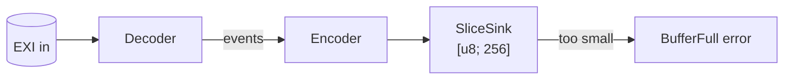

# Small devices

In this chapter you'll use rexi without the standard library and write into a
fixed buffer.

*This chapter is for Rust only.*

`rexi-core` and `rexi-serde` work without the standard library
([`no_std`](glossary.md#no_std)). They need only `alloc`, and only for their
[string tables](glossary.md#string-table). To use them on a microcontroller,
turn off the default features:

```toml
rexi-core = { git = "https://github.com/nhenehan/rexi", tag = "v0.1.0", default-features = false }
```

The output doesn't have to go into a growing `Vec`. A `SliceSink` writes into a
byte array you already own. If the array is too small, encoding stops cleanly
with `BufferFull`. It never writes past the end.



```rust,ignore
{{#include ../../examples/basics/src/bin/fixed_buffer.rs:main}}
```

```text
256-byte buffer: used 129 bytes
same bytes as the Vec version: true
32-byte buffer: refused, buffer full
```

This example decodes one stream and writes it again (a *transcode*), because
reading XML text needs `std`. On a real device you would write events from your
sensor data, as in [Writing events](write-events.md), using
[prebuilt tables](prebuilt-tables.md).

The `crates/rexi-nostd-check` crate builds this same code for a bare-metal Arm
chip (`thumbv7em-none-eabihf`). That shows nothing in it needs an operating
system.
