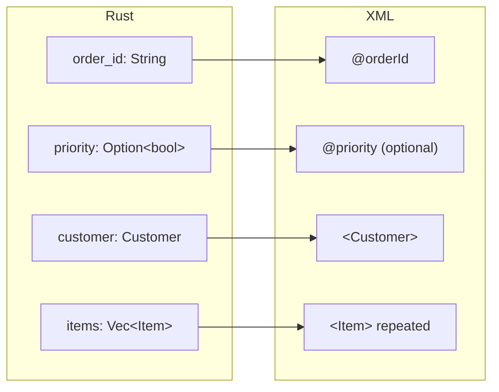

# Rust structs

In this chapter you'll turn your own Rust types into EXI and back with one call
each.

Writing events by hand gets long. With `rexi-serde`, you describe the document
once as Rust types and let [serde](glossary.md#serde) do the walking.

```rust,ignore
{{#include ../../examples/basics/src/bin/structs.rs:types}}
```

The schema decides where each field goes, so you never mark a field as an
attribute or an element yourself:



| Rust | XML |
|---|---|
| `Option<T>` | An item that may be missing |
| `Vec<T>` | An item that repeats |
| `#[serde(rename = "...")]`, `rename_all` | Match Rust names to XML names |
| An enum | A choice between elements |

Then encoding and decoding are one call each:

```rust,ignore
{{#include ../../examples/basics/src/bin/structs.rs:main}}
```

```text
EXI: 129 bytes
same bytes as encoding order.xml: true
decodes and encodes to the same bytes: true
order ORD-2026-0007 for Raven Bookstore (gold)
  2 x Distributed Systems Patterns     42.95
  1 x Practical EXI                    31.50
  total 117.40
  notes: gift-wrap requested
```

The bytes are the same as when you encode the XML file. EXI doesn't care how you
made the [events](glossary.md#event), only what they are.
