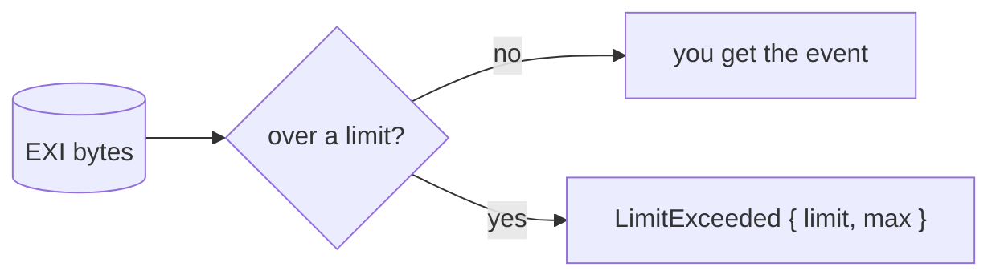

# Untrusted input

In this chapter you'll learn how rexi guards against hostile streams and
schemas, and how to loosen those guards for data you trust.

EXI is small on purpose, and that cuts both ways. Seven bytes can claim a list
of four billion items. One long string can come back a million times, because a
repeat from the [string table](glossary.md#string-table) costs only a few bits.
So the decoder keeps four limits. They are on by default and set far above what
real documents need.

| Limit | Default | What it stops |
|---|---|---|
| `max_depth` | 256 | Elements nested too deep |
| `max_list_items` | 1,000,000 | A list that claims a giant item count |
| `max_integer_bits` | 4096 | Huge numbers, whose cost grows with the square of their length |
| `max_string_bytes` | 256 MiB | Too much text in total, across every string value |

Each check sits right where the costly work would start, so a bad stream is
stopped before it costs anything:

Going over a limit stops decoding at once with `LimitExceeded`, for example
`decoder limit exceeded: nesting depth is over 256`. Nothing is cut short
quietly. The limits apply only to decoding, and they are not EXI
[options](glossary.md#options): the two sides don't need to agree on them.

## Changing a limit

If you trust the data and it really is that big, raise just the limit you need.

- **Rust:** `DecodeLimits::default().with_max_depth(Some(1024))`, then
  `Decoder::with_limits(..)`. `None` means no limit, and
  `DecodeLimits::unlimited()` turns them all off. rexi-xml and rexi-serde have
  `*_with_limits` versions of their decode functions, such as
  `decode_to_xml_with_limits` and `from_exi_with_limits`.
- **C:** fill a `RexiLimits` from `rexi_limits_default()` (0 means no limit) and
  call `rexi_decoder_new_with_limits` or `rexi_decode_with_limits`. Going over
  gives `REXI_STATUS_ERR_LIMIT`.
- **Command line:** `decode`, `dump-events` and `bench decode` take
  `--max-depth N`, `--max-list-items N`, `--max-integer-bits N` and
  `--max-string-bytes N` (0 means no limit), or `--no-limits`.

## Untrusted schemas

A [schema](glossary.md#schema) can pull in other files with `xs:include` and
`xs:import`. A hostile one could name `../../../etc/passwd`, `/dev/zero` or a
named pipe. So schema loading has rules, on by default:

- **Only under the main schema's folder.** A location outside it, or a symbolic
  link that leads outside, is refused before any file is touched, so the error
  never tells whether the file exists. A schema held in memory uses its base
  folder; with none, it may not include anything.
- **Only regular files,** at most 16 MiB each. No pipes, no devices, no URLs.

Breaking a rule gives `SchemaError::Refused`. Some real sets, like UBL
(`../common/...`), reach outside their folder. Set the root to the top folder
with `SchemaLoadOptions::default().with_root(SchemaRoot::Folder(..))` and
`compile_files_with`, `rexi_tables_from_xsd_with_root` in C, or
`--schema-root DIR`. `SchemaRoot::Anywhere` (`"/"` in C) allows any local file.

### Grammar size

A `maxOccurs="4000000000"` would ask for four billion copies of a particle. So
one type's content may grow to at most 100,000
[grammar](glossary.md#grammar-grammar-tables) rules (`maxOccurs` of 10,000 makes
about 20,000). The work to simplify a grammar is capped too, so a `maxOccurs` of
a few thousand is fine and `"20000"` is refused. Going over gives
`SchemaError::TooLarge`; raise it with `with_max_grammar_size(Some(n))`. A group
that contains itself has no end and gives `SchemaError::Invalid`. A loop through
a global element or a named type is fine.
