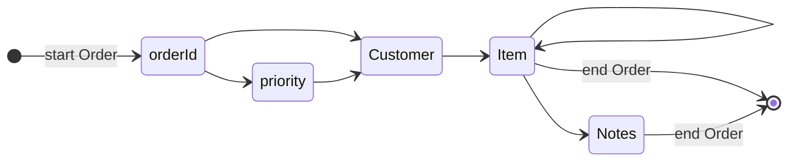

# Writing events

In this chapter you'll build an EXI document straight from your program's data,
with no XML text.

The encoder works like the decoder in reverse: you call one method per
[event](glossary.md#event).

```rust,ignore
{{#include ../../examples/basics/src/bin/write_events.rs:main}}
```

```text
EXI: 129 bytes
same bytes as encoding order.xml: true
```

## The encoder follows the schema

The schema works like a map of what may come next. After `start Order`, the
encoder expects `@orderId`, then maybe `@priority`, then a `Customer`, and so
on:



If you call something out of order, such as `Item` before `Customer`, the
encoder stops with an error that says what it expected. Two rules often trip
people up:

- **Attributes come first, sorted by name.** [Strict](glossary.md#strict-and-non-strict)
  EXI wants them in the schema's sorted order, before any child elements.
- **Unqualified attributes have no namespace.** This schema puts elements in
  `urn:rexi:interop:order`, but attributes use `""`.

## Three ways to pass a value

| `Value` | Meaning |
|---|---|
| `Value::String("gold")` | Text for a string field |
| `Value::Boolean(true)`, `Value::Integer(..)` | A typed value, used as it is |
| `Value::Lexical("42.95")` | A [text value](glossary.md#text-lexical-value) that rexi parses with the schema's type, just like text from an XML file |

`Lexical` is the easy choice when your data is already text. Typed values skip
the parsing.
